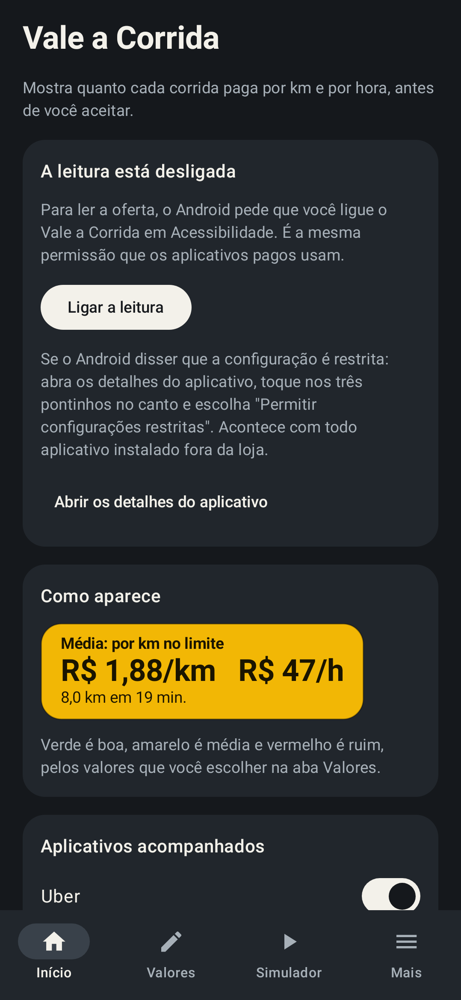
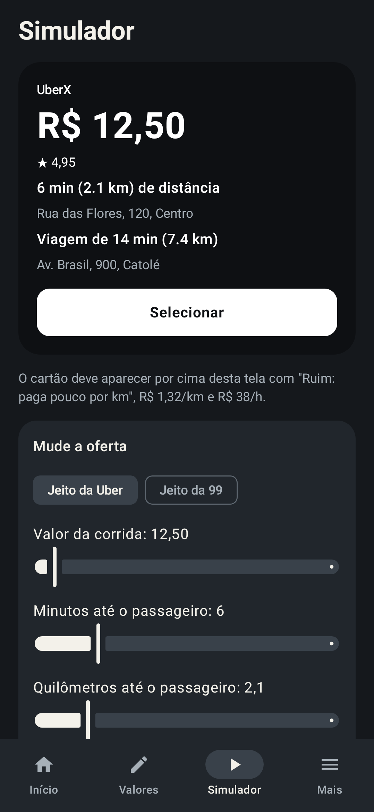

# Vale a Corrida

Aplicativo Android, de código aberto, para motoristas de aplicativo. Quando chega uma oferta de
corrida na Uber, na 99 ou no inDrive, ele lê a tela e mostra por cima, antes de você aceitar,
**quanto a corrida paga por km e por hora**, em verde, amarelo ou vermelho, segundo os valores que
você mesmo escolheu.

Já existem aplicativos que fazem isso, pagos. Este é gratuito, e o código está aqui para qualquer
pessoa conferir o que ele faz com a permissão que recebe.

<p>
  
  
</p>

## Estado do projeto

Versão 0.1, a primeira. O que foi conferido e o que não foi:

- **Conferido:** o leitor de ofertas e as contas, com 45 testes automáticos; as telas, desenhadas
  em computador e olhadas uma a uma; o APK, que compila, sai assinado e sem permissão de internet.
- **Ainda não conferido:** o aplicativo rodando num celular, e a leitura das ofertas de verdade
  da Uber, da 99 e do inDrive. Os formatos de oferta dos testes foram escritos de memória.

Se você instalar e o cartão não aparecer, isso é esperado nesta fase, e é exatamente o aviso que
o projeto precisa: veja [Como ajudar](#como-ajudar).

## O que ele faz

- Lê da oferta o valor, a distância e o tempo até o passageiro e da viagem.
- Calcula reais por km e reais por hora, somando o caminho até o passageiro.
- Mostra um cartão por cima da oferta: **Boa**, **Média** ou **Ruim**, em palavra e em cor.
- Aceita limites: valor mínimo da corrida, distância máxima até o passageiro, nota mínima.
- Se você informar o seu custo por km, mostra também quanto sobra.
- Tem um simulador, para ver o cartão funcionando sem estar online.

O que ele **não** faz: não aceita nem recusa corridas, e não toca na tela por você.

## Privacidade

- **Sem permissão de internet.** O que é lido da tela serve para fazer a conta e é descartado.
  Nada sai do aparelho. Dá para conferir no `AndroidManifest.xml` e no APK.
- Só lê a tela enquanto a Uber, a 99 ou o inDrive estão abertos, e só os que você deixar ligados.
- Guardar leituras para diagnóstico é opcional, vem desligado e fica só no aparelho.

## Instalar

Só Android, da versão 8 em diante. No iPhone não é possível: o iOS não deixa um aplicativo ler a
tela de outro.

1. Baixe o APK em [Releases](https://github.com/fabrinygabrielrc-eng/vale-a-corrida/releases) e
   instale. O Android vai pedir para permitir a instalação de fora da loja.
2. Abra o Vale a Corrida e toque em **Ligar a leitura**. Na tela de Acessibilidade, ligue o
   Vale a Corrida.
3. Se o Android disser que a configuração é restrita (Android 13 em diante, com todo aplicativo
   instalado fora da loja): abra os detalhes do aplicativo, toque nos três pontinhos no canto e
   escolha **Permitir configurações restritas**. Depois repita o passo 2.
4. Na aba **Valores**, ponha os seus números. Na aba **Simulador**, confira se o cartão aparece.

## Antes de usar

- As plataformas não gostam de aplicativos que leem as ofertas. A Uber já foi à Justiça contra um
  deles, e há notícia de restrição a contas que usavam ferramentas parecidas. Use sabendo do risco.
- A conta depende do que o aplicativo de corrida mostra. Quando ele muda a tela, o cartão pode
  parar de aparecer até o leitor ser atualizado.
- Este projeto não tem vínculo com a Uber, a 99 ou o inDrive. As marcas são dos seus donos.

## Como funciona

```
nucleo/   Kotlin puro: acha a oferta no texto da tela e faz as contas. Testado sem Android.
app/      O aplicativo: serviço de acessibilidade, cartão por cima da tela e as telas de ajuste.
```

1. O serviço de acessibilidade é avisado quando um aplicativo de corrida muda a tela.
2. Ele recolhe o texto que o aplicativo entrega ao Android. Se o texto da oferta não vier
   (alguns aplicativos escondem), tira uma captura da tela e reconhece o texto no próprio aparelho.
3. O leitor procura um valor em reais e os trechos de "tempo + distância". Ele não depende do
   desenho de um aplicativo específico, por isso aguenta mudanças de tela.
4. O avaliador compara com os seus valores e o cartão aparece.

O reconhecimento de texto na imagem usa o ML Kit do Google, que roda no aparelho. O envio de
estatísticas que essa biblioteca faria foi desligado junto com a permissão de internet.

### Compilar

Precisa do JDK 17 e do SDK do Android (o Android Studio traz os dois).

```
./gradlew test                        # todos os testes
./gradlew :app:assembleDebug          # gera app/build/outputs/apk/debug/app-debug.apk
./gradlew :app:recordRoborazziDebug   # desenha as telas em app/build/telas, sem celular
```

## Como ajudar

A ajuda que mais vale: avisar quando uma oferta não foi reconhecida. Na aba **Mais**, ligue
**Guardar as últimas leituras**, espere a oferta aparecer de novo, toque em **Compartilhar** e
abra uma [issue](https://github.com/fabrinygabrielrc-eng/vale-a-corrida/issues/new/choose) com o
texto. Apague endereços e nomes antes de enviar. Cada leitura enviada vira um teste novo.

Para quem programa, o passo a passo está em [CONTRIBUTING.md](CONTRIBUTING.md).

### O que vem pela frente

- Conferir e ajustar o leitor com ofertas de verdade de cada aplicativo.
- Histórico do dia: corridas vistas, aceitas e quanto renderam.
- Leitura de imagem com biblioteca livre, para o aplicativo poder entrar na F-Droid.
- Arrastar o cartão para onde o motorista preferir.

## Licença

[MIT](LICENSE).

---

**In English:** Vale a Corrida ("is the ride worth it?") is an open-source Android app for
ride-hailing drivers in Brazil. It reads the ride offer shown by Uber, 99 or inDrive (through an
accessibility service, with on-device OCR as a fallback) and overlays the earnings per km and per
hour, colour-coded against thresholds the driver sets. It has no internet permission, and it never
accepts or declines rides on the driver's behalf.
